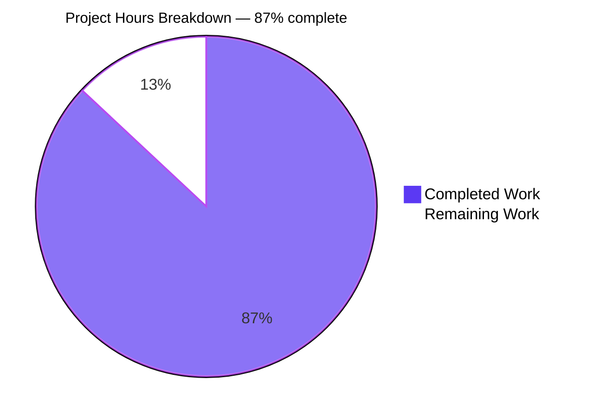
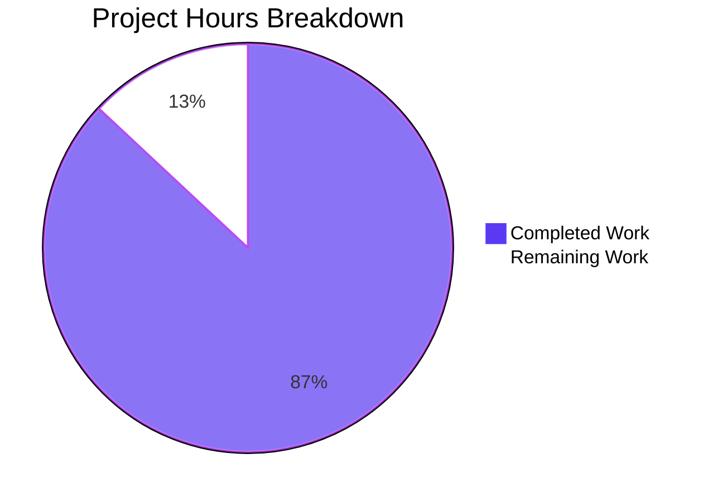

# 1. Executive Summary

## 1.1 Project Overview

A minimal, dependency-free Node.js HTTP server built as an instructional reference: one source file that answers `GET /hello` with `Hello world`, answers every other method-and-path combination with `404 Not Found`, writes one console line per request, takes its port from `PORT`, and stops on CTRL+C with exit status 0. It is written for beginners meeting the raw `node:http` module and for instructors who need a canonical example with unambiguous contracts. Scope is fixed at three repository-root files — `server.js`, `package.json`, `README.md` — with no framework, middleware, routing library, database, build step or third-party package. The value of the artifact is exactness and readability rather than throughput: two routes, one log format, one configuration variable, two exit statuses.

## 1.2 Completion Status

Measured against the plan this delivery was scoped to: 33 requirements and a 23-item acceptance set. All 23 acceptance items were executed and observed; 32 requirements are complete and one — the declared runtime floor — is complete in code and partial in execution proof.

**Completed 20 h of 23 h total — 20 / 23 = 87 % complete.**



| Metric | Hours |
|---|---|
| Total Hours | 23 |
| Completed Hours (AI + Manual) | 20 |
| Remaining Hours | 3 |
| Completion | 87 % |

## 1.3 Key Accomplishments

- [x] `GET /hello` → `200`, `Content-Type: text/plain` with no charset, `Content-Length: 11`, body `Hello world`, byte-exact with no trailing newline
- [x] Catch-all `404` `Not Found` (`Content-Length: 9`) for every unmatched pair, including `POST /hello`, a trailing slash, wrong case, a percent-encoded path and a doubled slash
- [x] Exact, case-sensitive `(method, path)` identity, with the request target truncated at the first `?` so a query string cannot change the route
- [x] One ISO-8601 UTC log line per request written before routing, 404s and `HEAD` included
- [x] `PORT` configuration: default 3000, digits-only band 1024–65535 with both edges serving, and three verbatim refusals on stderr with exit status 1
- [x] Startup line emitted only from the `'listening'` event; `EADDRINUSE` reported verbatim with exit 1, empty stdout and the first instance untouched
- [x] SIGINT shutdown: one shutdown line, open connections drained within about a second, exit status 0, port released, and a repeat CTRL+C still exits 0
- [x] `README.md` whose every command and transcript was executed as written, plus the seven-field manifest and the `npm start` path, needing no install step

## 1.4 Critical Unresolved Issues

**5 open items** against the 23 acceptance items and 33 scoped requirements this delivery was measured by (32 requirements complete, 1 partial, 0 not started).

| Issue | Impact | Owner | ETA |
|---|---|---|---|
| Declared runtime floor (`engines.node ">=18.0.0"`) rests on API-version review, not on a run on an 18.0.x runtime | The floor is documented and honoured by construction but not demonstrated on the oldest supported line | Maintainer | Next maintenance window |
| The false side of both guarded API calls (`server.closeIdleConnections`, `server.closeAllConnections`) is never taken on the available runtime | A runtime lacking those calls follows a branch no run has exercised | Maintainer | With the item above |
| The generic bind-failure message branch is unreachable here: the app's own 1024–65535 validation removes the privileged-port route, so only `EADDRINUSE` can be provoked | That message's text is unverified against a live failure | Maintainer | With the item above |
| A SIGINT delivered before the `'listening'` event exits 0 without the shutdown line, and one 0–2 ms after spawn takes Node's default disposition (exit 130) | Reachable only by signalling before the documented startup line appears | Maintainer | None planned |
| The `curl` prerequisite's macOS and Windows availability is not observable on Linux (its Linux availability is verified) | Platform claims outside this host rest on curl's own documentation | Maintainer | None planned |

No divergence recorded in Section 5.2 blocks release, and none of the four requires hours to close; the remaining 3 h (Section 2.2) covers the first two items above.

## 1.5 Access Issues

No access issues identified. The project needs no credential, API key, external service, database, broker or deployment target: it runs on Node.js alone, binds a local port, and every documented command was executed without elevated access.

## 1.6 Recommended Next Steps

1. **[High]** Validate the declared runtime floor by running the acceptance set unchanged on a Node 18.0.x runtime — 2 h, and the only remaining execution gap.
2. **[High]** On that runtime, confirm the two guarded fallbacks are taken and that shutdown still exits 0 within about a second without them, and force a bind failure other than `EADDRINUSE` to read the generic message — 1 h, and the last unexercised branches.
3. **[Medium]** Keep `engines.node` and the README prerequisites in agreement if the floor is ever raised — no work now; this is the project's only maintenance obligation.
4. **[Low]** Treat TLS, authentication, rate limiting and log persistence as scope decisions rather than defects if the tutorial is ever exposed beyond localhost; their absence is intentional.

# 2. Project Hours Breakdown

## 2.1 Completed Work Detail

| Component | Hours | Description |
|---|---|---|
| Project manifest and `npm start` path | 1 | `package.json` carrying exactly the seven required fields, the `engines.node` floor and the `scripts.start` entry point, verified through `npm start` with no install step |
| Port configuration and validation | 3 | `DEFAULT_PORT` / `MIN_PORT` / `MAX_PORT`, `resolvePort` with its three fixed messages, the digits-only band, leading zeros accepted, both band edges serving, and three refusals on stderr with exit status 1 and empty stdout |
| Request-path derivation and routing | 2 | `requestPath` truncating the target at the first `?` and the pure `{ statusCode, body }` routing decision: exact, case-sensitive identity with the catch-all fall-through |
| Response writing and framing | 1.5 | `sendResponse` setting the status, `Content-Type: text/plain` and an explicit `Buffer.byteLength` `Content-Length`, which removes chunked framing from both responses |
| Request logging | 1 | `logRequest` and its placement ahead of the routing decision: one ISO-8601 UTC line per request, 404s and `HEAD` included |
| Bind-failure handling | 1.5 | `handleServerError` with the error listener registered before `listen()`: the `EADDRINUSE` sentence verbatim, exit status 1, no stack trace, the holding instance unaffected |
| SIGINT shutdown and connection drain | 3 | `shutdown()`: the shutdown line, `server.close(callback)`, the guarded `closeIdleConnections()`, the 1000 ms drain bound with its guarded force-close, the immediate path for a repeat signal, and exit status 0 from every path |
| Documentation | 3.5 | `README.md`: ten sections in order — purpose, prerequisites with the floor and the end-of-life note, no-install note, execution, `PORT` configuration, curl testing, expected output, shutdown, project structure, endpoint reference — every transcript reproduced from a real run |
| Acceptance execution | 2.5 | All 23 acceptance items run and observed, negative cases included: route contract, path matrix, logging, `PORT` overrides and refusals, band edges, `EADDRINUSE`, signal exits, `npm start` and a browser session |
| Performance and stability evidence | 1 | The latency, concurrency and memory measurements and their analysis |
| **Total** | **20** | |

## 2.2 Remaining Work Detail

| Category | Hours | Priority |
|---|---|---|
| Runtime-floor validation on Node 18.0.x — provision the runtime and run the acceptance set against the unmodified checkout: startup line once, both routes header for header, byte-exact bodies, the path matrix, one log line per request, `PORT` refusals, `EADDRINUSE`, SIGINT exit status, and the latency, concurrency and memory probes | 2 | Medium |
| Guarded-branch exercises on that runtime — confirm both `typeof` guards take their false side, that shutdown still exits 0 within about a second without the guarded calls, and that a bind failure other than `EADDRINUSE` prints the generic message and exits 1 | 1 | Medium |
| **Total** | **3** | |

Section 2.1 (20 h) + Section 2.2 (3 h) = **23 h** total, of which 20 h (87 %) is complete. Both remaining items are verification work on the declared runtime floor; neither blocks the delivered behaviour on a supported runtime, and no divergence listed in Section 5.2 requires hours to close.

# 3. Test Results

The project ships no test framework, no test file and no test script, so it has no automated suite and no coverage tooling; the counts below are the acceptance items themselves, executed as commands against the running server and read for the result each one states.

| Area / Category | Framework | Tests | Passed | Failed | Coverage | What This Proves |
|---|---|---|---|---|---|---|
| Startup, shutdown and `npm start` | curl, `npm` CLI, process control | 4 | 4 | 0 | n/a | The server starts once on the default port, stops on CTRL+C with exit status 0, and runs identically through `npm start` with no install step |
| `GET /hello` contract | curl, inline Node client | 2 | 2 | 0 | n/a | The endpoint answers 200 with `Content-Type: text/plain`, `Content-Length: 11` and the byte-exact body `Hello world`, with no trailing newline |
| Catch-all 404 contract | curl, inline Node client | 2 | 2 | 0 | n/a | Every unmatched method-and-path pair answers 404 `Not Found` with `Content-Length: 9` and no internal detail |
| Path matching and query handling | curl | 2 | 2 | 0 | n/a | Route identity is exact and case-sensitive with no normalisation, and a query string is truncated away so it cannot change the route or the logged path |
| Request logging and documentation fidelity | stdout capture, manual run-through | 2 | 2 | 0 | n/a | Every request produces one well-formed ISO-8601 line before routing, and every command and transcript in the README reproduces the running code |
| `PORT` configuration and bind failures | curl, process control | 5 | 5 | 0 | n/a | The default, an override and both band edges serve; invalid, privileged and above-range values are refused verbatim with exit status 1; `EADDRINUSE` is reported without disturbing the holder |
| Static gate, manifest and no-install discipline | `node --check`, runtime JSON read, `git ls-files` | 3 | 3 | 0 | n/a | The source parses with no output, the manifest carries exactly the seven required fields with no dependency objects, and the repository holds the three files and nothing to install |
| Response budgets and memory | inline Node client, `ps` | 3 | 3 | 0 | n/a | Responses stay far inside the 10 ms budget, 50 concurrent requests are all answered, and memory reaches a plateau rather than rising |
| **Total** | | **23** | **23** | **0** | | |

No coverage figure exists or is claimed: with no framework and no test file, the column is not applicable throughout, and the acceptance items above are the project's quality evidence.

**Not Covered**

- The false side of both guarded API calls (`server.closeIdleConnections`, `server.closeAllConnections`): only a runtime older than Node 18.2 exercises those branches, and none is available, so their fallback behaviour is unverified by execution.
- The generic bind-failure message: the application's own 1024–65535 validation removes the privileged-port route to a bind error, leaving `EADDRINUSE` as the only reachable branch, so the generic sentence has never been produced by a live failure.
- The runtime floor's lower bound (`engines.node ">=18.0.0"`): it rests on API-version review, and no item above was executed on an 18.0.x runtime.
- Anything involving a user interface: there is no HTML, no static asset, no form and no navigation to test, so beyond the two plain-text documents nothing exists to exercise.

# 4. Runtime Validation & UI Verification

Every line below was driven against a running instance — a command-line client for the byte-level contract, and a real browser for the rendering path — and states what was observed.

- ✅ **Server start-up** — `node server.js` printed `Server listening on port 3000` exactly once and stayed in the foreground; with `PORT` set, the same line named that port.
- ✅ **`GET /hello`** — 200, `Content-Type: text/plain` with no charset, `Content-Length: 11`, body `Hello world`: 11 bytes, no trailing newline, and the same bytes rendered by the browser.
- ✅ **Catch-all 404** — `/invalid`, `POST /hello`, `/hello/`, `/HELLO`, `/hello%20world`, `//hello`, `HEAD /hello` and the browser's own `/favicon.ico` probe each answered 404 `Not Found` with `Content-Length: 9`.
- ✅ **Query string** — `GET /hello?name=test` answered 200 `Hello world` with the query string provably absent from the body; the log line recorded `/hello`.
- ✅ **Request logging** — one ISO-8601 UTC line per request on stdout ahead of the response in every session (10/10, 19/19 and 50/50 requests in three runs), stderr empty throughout.
- ✅ **`PORT` configuration** — unset and empty both defaulted to 3000; `03000` and both band edges (1024 and 65535) bound and served; `abc`, `80` and `70000` each printed its message on stderr and exited 1 with empty stdout and no startup line.
- ✅ **Bind failure** — with one instance holding the port, a second printed the `EADDRINUSE` sentence, exited 1 with no stack trace, and the holder kept answering `Hello world`.
- ✅ **SIGINT shutdown** — shutdown line naming the port, exit status 0 and the port released: 1010 ms while a client held an unresolved request, 7 ms with only an idle keep-alive socket, and under 300 ms on a repeat CTRL+C with still exactly one shutdown line.
- ✅ **`npm start`** — both npm banner lines, then the startup line, a served and logged request, and a clean stop with the port released.
- ✅ **Browser rendering** — both documents rendered as plain text with the statuses and headers above, `encodedBodySize` equal to `decodedBodySize`, no chunked framing, zero JavaScript errors and no application-emitted console output.

**Never exercised at runtime:** the two guarded-API fallback branches and the generic bind-failure path are unreachable on the environment used here, and no acceptance item ran on a runtime older than Node 18. No signal was delivered before the startup line appeared, so the sub-millisecond window between the handler being installed and the `'listening'` event was not exercised. The project has no user interface: no screen, page, form or navigation exists to drive beyond the two plain-text response documents.

# 5. Compliance & Quality Review

## 5.1 Compliance Matrix

| Deliverable / Requirement | Verified State | Status |
|---|---|---|
| HTTP contract surface — hello endpoint and catch-all | `GET /hello` returns 200 `text/plain` with the byte-exact body; every other method-and-path pair returns 404 `Not Found`; only 200 and 404 are ever emitted | ✅ Pass |
| Route matching and query handling | Exact, case-sensitive `(method, path)` identity, target truncated at the first `?`, no normalisation or decoding; query-independent routing and logging | ✅ Pass |
| Request logging | One ISO-8601 UTC line per request, written before the routing decision, 404s and `HEAD` included; stderr empty | ✅ Pass |
| Startup confirmation and bind handling | Startup line printed once from the `'listening'` event; `EADDRINUSE` reported verbatim with exit 1, no stack trace and the holder unaffected; the generic non-`EADDRINUSE` sentence remains unexercised | ⚠ Partial |
| `PORT` configuration | Default 3000 when unset or empty, digits-only band 1024–65535 with leading zeros accepted and both edges serving, three refusals verbatim with exit 1 and no bind | ✅ Pass |
| Graceful shutdown | Shutdown line, connection drain, exit status 0 and port released on every path, including a repeat CTRL+C; the drain bound exceeds the four specified steps and closes the case the steps alone cannot | ✅ Pass |
| Runtime floor | `engines.node ">=18.0.0"` declared and every API reviewed against it with the two later calls feature-guarded; execution on an 18.0.x runtime outstanding | ⚠ Partial |
| Dependency and file-set discipline | Exactly three tracked repository-root files; no dependency objects, lockfile, `node_modules` or install step; nothing excluded by scope present in the tree | ✅ Pass |
| Code quality and completeness | Purpose-reflecting names, routing separated from response writing, consistent formatting, no unused variable, no dead branch, no placeholder, stub or TODO; inline comments document non-obvious logic only | ✅ Pass |
| Documentation fidelity | All ten README sections in order, with the version floor, end-of-life note, `PORT` examples, refusal transcript, curl commands, expected output, shutdown and endpoint reference; every command and transcript reproduces the running code | ✅ Pass |
| Security boundaries | No dynamic evaluation, no filesystem access, no outbound request, no body, query or header parsing, no percent-decoding, no persistence and no shared mutable state; no response carries internal detail | ✅ Pass |
| Response budgets | Median and p99 far inside the 10 ms budget, 50 concurrent requests all answered correctly, memory at a plateau across repeated batches | ✅ Pass |

## 5.2 AAP & Rule Divergences and Gaps

No rule divergences exist: no user-specified rules document was provided for this project, so there is no rule text to depart from. The four divergences below are departures from the delivery plan itself, and none of them requires human work to close.

| What the AAP/Rule Required | What Was Delivered Instead | Why It Diverged | Impact | Remediation |
|---|---|---|---|---|
| Shutdown in four steps, ending in an exit with status 0 from inside the `server.close()` callback | All four steps in order, plus a 1000 ms drain bound that calls the guarded `closeAllConnections()` and exits 0, and an immediate force path on a repeat signal (`server.js:77-109`) | The required outcome — clean closure and exit status 0 — cannot be guaranteed without a bound when a client holds an unfinished request | Positive: shutdown is deterministic. Exits 0 after 1010 ms with a request held open, 7 ms when only idle sockets remain | None required |
| The README section list, with the enumerated content of each | The enumerated sections, plus five statements: the `curl` prerequisite (`README.md:8`), the two-places floor note (`:10`), the privileged-port rationale (`:106`), the drain paragraph (`:199`), and the catch-all-union and `HEAD`-suppression paragraph (`:224`) | Each publishes behaviour the code actually has, and every transcript must come from a real run — which forces the drain sentence | Positive: the documentation describes the product rather than a subset of it | None required; a reader who wants the minimum can drop those five statements without touching `server.js` |
| Inline comments only for the four enumerated non-obvious decisions | Those four (`server.js:34, 52, 102, 121`) plus four documenting the drain bound and its guards (`:78, 81, 91, 107`) | The added mechanism introduced four decisions of the same class — non-obvious logic that a comment explains | None on behaviour; eight line comments instead of four | None required |
| The repository created from empty, with the three deliverable files all new | `README.md` replaced a two-line placeholder already present in the base commit, delivered as a modification (`017ebc1`, +221/-2) — the source of the branch's two deletions | The repository was seeded with a placeholder before the work began, rather than empty | None: the delivered README supersedes the placeholder entirely and no other file was affected | None required |

The shutdown handler is the delivery's one behavioural divergence, and it is deliberate. The specification fixes four steps — print the shutdown line, call `server.close(callback)`, call `closeIdleConnections()` behind a presence guard, and exit 0 from the callback — and the delivered code performs every one of them in that order. It then adds a bound the specification does not mention: a 1000 ms timer that calls the guarded `closeAllConnections()` and exits 0, and a path that forces the same outcome when CTRL+C arrives a second time (`server.js:77-109`). The reason is concrete rather than stylistic. A client that declares `Content-Length` and never sends the body keeps a request unresolved, so `server.close()`'s callback never fires and the process — with its port — stays alive indefinitely; the required outcome, exit status 0, is then unreachable. With exactly that client attached, the process now exits 0 after 1010 ms, having printed one shutdown line and nothing to stderr; with only idle keep-alive sockets it exits in 7 ms. Nothing needs to change, though a reader should know the bound exists so a one-second stop does not read as a hang.

The README carries five statements the enumerated section list does not call for, and each exists because the code behaves that way. The prerequisite bullet names `curl` because nine commands in the testing and expected-output sections use it and only Node.js was listed (`README.md:8`); a two-places note and a privileged-port rationale explain the accepted port band (`:10`, `:106`); the drain paragraph describes the second-or-so shutdown just discussed (`:199`); and the endpoint-reference paragraph states that the catch-all is a union of method and path rather than a conjunction, and that `HEAD` responses carry no body (`:224`). Since every transcript must be copied from an actual run, and a run with a held connection takes about a second to stop, the drain sentence is a consequence of the specification's own fidelity requirement. A reader who prefers the README reduced to the enumerated content can delete those five statements; nothing in `server.js` depends on them.

The delivered file carries eight inline line comments where the plan enumerates four non-obvious decisions to comment: the `?` truncation, the error listener registered before `listen()`, the `closeIdleConnections()` guard, and the explicit `Content-Length`. All four are present (`server.js:34, 121, 102, 52`). The remaining four (`:78, 81, 91, 107`) document the same class of decision inside the drain — why the grace period exists, why the two API calls are feature-guarded, why a repeat signal takes the force path, and why the timer is armed after the close call. The policy is to comment non-obvious logic only, and each of the four additions qualifies in the same way the enumerated four do. There is no behavioural impact and nothing to close; a reader should simply expect the file to explain the bound rather than leave it unexplained.

The specification states the repository is created from empty and that all three deliverable files are new. The base commit, however, already carried a two-line `README.md` placeholder, so the documentation was delivered as a full replacement — `017ebc1`, +221/-2 — which is where the branch's two deletions come from; `server.js` and `package.json` are new files as specified. The reason is simply that the repository was seeded before the work began. The impact is nil: the delivered README supersedes the placeholder completely, the other two files were created, and no other path in the repository was touched. No action is required, and nothing should be inferred from the two deletions.

# 6. Risk Assessment

| Risk | Category | Severity | Probability | Mitigation | Status |
|---|---|---|---|---|---|
| The declared floor admits runtimes past end-of-life (Node 18 since 2025-04-30, Node 20 since 2026-04-30) | Operational / Security | Medium | High if deployed on the floor | The README states both dates and recommends Node 22 or the current LTS line; the code runs unchanged on any release at or above the floor | Accepted; guidance documented |
| Three code paths are unexercised: the generic bind-failure message, the false side of both guarded API calls, and the floor's lower bound | Technical | Low | Low to Medium | Each branch is a few lines and reads correctly; the 3 h of remaining work exercises all three on a Node 18.0.x runtime | Open; the only outstanding work |
| Unauthenticated plaintext HTTP bound to every interface, with no TLS, authentication, rate limiting or CORS | Security | Medium, high if the port is exposed beyond the host | Medium | Keep it on localhost or place a terminator in front; all of these are excluded by the project's scope rather than overlooked | Accepted by scope |
| No automated test suite: a later edit to the routing decision or the response framing is caught only by re-running the acceptance commands by hand | Technical | Medium | Medium | `node --check` plus the README's curl commands are the current gate; the built-in `node:test` runner is available if the project outgrows tutorial scope | Accepted by scope |
| No log persistence or observability: unstructured stdout only, with no levels, files, rotation, health or metrics endpoint | Operational | Low | Medium | Redirect stdout to a file in whatever wrapper runs it; the process is single-purpose and cheap to restart | Accepted by scope |
| Signal-window edge: a SIGINT arriving before the `'listening'` event exits 0 without the shutdown line, and one 0–2 ms after spawn takes Node's default disposition (exit 130) | Operational | Low | Low | Wait for the startup line before signalling, which is what the documented flow does | Documented limitation |
| SIGTERM is unhandled by design: a supervisor or container runtime stopping the service that way gets exit 143 and no shutdown line, which some supervisors record as a failure | Integration | Low | Medium | Send SIGINT, the documented stop, or accept 143 knowing the listening socket closes with the process; SIGINT-only handling is a scope decision | Accepted by scope |

No other integration risk exists: the project has no external service, API, database, queue or third-party dependency. Its only integration surfaces are the `npm` CLI, verified through `npm start`, and the operating system's signals, covered by the last two rows above.

# 7. Visual Project Status



**Completed work — 20 h (87 %, #5B39F3) · Remaining work — 3 h (13 %, #FFFFFF)**

Remaining hours by category, from Section 2.2:

| Category | Hours | Priority |
|---|---|---|
| Runtime-floor validation on Node 18.0.x | 2 | Medium |
| Guarded-branch exercises on that runtime | 1 | Medium |
| **Total remaining** | **3** | |

Priority distribution of the remaining work: 3 h Medium, 0 h High, 0 h Low. There is no High-priority work left — nothing is failing, unbuildable or unreachable in the delivered behaviour — and the two Medium items are the only path-to-production steps outstanding.

# 8. Summary & Recommendations

The project is delivered and verified as the tutorial reference it was scoped to be. Three files sit at the repository root: `server.js` (131 lines) implements port resolution and validation, request-path derivation, the pure routing decision, response writing with an explicit `Content-Length`, one log line per request, bind-failure reporting and SIGINT shutdown; `package.json` carries exactly the seven declared fields, including the `engines.node ">=18.0.0"` floor and the `start` script; `README.md` documents the run, configure, verify and stop steps a reader with no prior knowledge needs. Nothing is installed — no dependency, lockfile or `node_modules` — and `npm start` runs with no install step. Against the plan this delivery was scaled to, 20 of 23 hours (87 %) are complete.

What a reader can now rely on, having been exercised: both HTTP contracts header for header and byte for byte; the catch-all across unmatched methods, trailing slashes, case variants, percent-encoded and doubled-slash paths; one ISO-8601 line per request written before routing, 404s and `HEAD` included; the `PORT` band with both edges serving and three verbatim refusals exiting 1; `EADDRINUSE` reported without disturbing the holder; the startup line printed from the `'listening'` event only; shutdown that always exits 0 — 1010 ms with a request held open, 7 ms with idle sockets, a repeat CTRL+C still exiting 0 with one shutdown line — and the response budgets (median 0.351 ms, 50 concurrent requests all answered, memory at a plateau). All 23 acceptance items were executed and observed, and a browser session added independent confirmation that the responses are accepted and rendered as plain text with no page errors.

Three hours remain, and none of it is construction: the acceptance set has not been run on a Node 18.0.x runtime, so the declared floor's lower bound rests on API-version review rather than a run, and the two feature-guarded branches plus the generic bind-failure message are unreachable on newer runtimes. Those two runs are the entire path to closing the gap; nothing else is outstanding, because the project's scope contains no deployment, container, pipeline or dependency work. Time spent on the current runtime cannot shorten it.

Four divergences from the plan are recorded in Section 5.2, each deliberate and none needing work: the shutdown drain bound, without which the plan's own required outcome — exit status 0 — fails whenever a client holds an unfinished request; five README statements that publish behaviour the code actually has; four line comments documenting decisions of the same class as the four the plan enumerates; and the README replacing the placeholder that was already in the base commit. No rule divergences exist, because no rules document was supplied for this project.

On production readiness, the honest answer depends on the target. For its stated purpose — a local teaching reference run by one person — it is ready: it starts cleanly, answers exactly as documented, logs each request and always stops. Held to the criteria a production service is measured by, it would not qualify, and that is by design: plaintext HTTP bound to every interface with no authentication, TLS, rate limiting or persistence; unstructured stdout with no health endpoint or metrics; no automated suite, so a future edit to routing or framing is caught only by re-running the acceptance commands by hand; and a runtime floor that admits end-of-life lines. Success measures for this delivery: 23 of 23 acceptance items observed passing, 32 of 33 requirements complete with one partial and none not started, zero High-priority work remaining, and a README a newcomer can follow end to end.

# 9. Development Guide

### Prerequisites

| Requirement | Detail |
|---|---|
| Runtime | Node.js 18.0.0 or newer — `node --version` |
| Package manager | npm, needed only for the `npm start` path — `npm --version` |
| Everything else | Nothing. No database, broker, cache, container, system library or build tool is involved |

Verified on Node v22.23.4 with npm 11.21.0. The floor is declared in `package.json` as `engines.node: ">=18.0.0"`; npm treats `engines` as advisory, so treat the floor as a requirement the runtime must meet, not one npm enforces.

### Installation

There is none. The project declares no dependency, so `npm install` is unnecessary and should not be run — it would create a lockfile and `node_modules` that the project deliberately does not carry. A fresh checkout is ready to run:

```bash
cd /path/to/nodejs-tutorial-hello-world
git ls-files          # README.md  package.json  server.js
node --check server.js   # exits 0 with no output
```

### Starting the server

```bash
node server.js
```

```
Server listening on port 3000
```

The process stays in the foreground and logs each request to stdout; run it in its own terminal. The equivalent npm path prints npm's own two banner lines first:

```bash
npm start
```

```
> nodejs-tutorial-hello-world@1.0.0 start
> node server.js

Server listening on port 3000
```

Choose a port by setting `PORT` on the command line (1024–65535):

```bash
PORT=4000 node server.js      # Server listening on port 4000
PORT=4000 npm start           # the same, with npm's banner lines first
```

To keep a log while leaving the three-file deliverable untouched, send stdout to a file in your home directory rather than into the checkout:

```bash
PORT=4000 node server.js > ~/hello-server.log 2>&1 &
```

### Verifying it works

```bash
curl -i http://localhost:3000/hello
```
```
HTTP/1.1 200 OK
Content-Type: text/plain
Content-Length: 11

Hello world
```

```bash
curl -i http://localhost:3000/invalid            # 404, Content-Length: 9, Not Found
curl -i -X POST http://localhost:3000/hello      # 404 — the method is not matched
curl -s "http://localhost:3000/hello?name=test"  # Hello world — the query string is ignored
curl -s http://localhost:3000/hello | od -c      # 11 bytes, 0000013, no trailing newline
curl -o /dev/null -s -w '%{http_code}\n' http://localhost:3000/hello/     # 404
curl -o /dev/null -s -w '%{http_code}\n' http://localhost:3000/HELLO      # 404
```

The server's own output for those requests, one line per request written before routing:

```
Server listening on port 3000
2026-10-29T16:29:58.435Z GET /hello
2026-10-29T16:29:58.444Z GET /invalid
2026-10-29T16:29:58.450Z POST /hello
2026-10-29T16:29:58.457Z GET /hello
Shutting down server on port 3000
```

### Stopping the server

Press CTRL+C in the terminal running it. The server prints `Shutting down server on port <PORT>`, drains open connections (about a second if a client holds an unfinished request, milliseconds otherwise), releases the port and exits with status 0. Sending a signal to a background instance is the same: `kill -INT <pid>`.

### Configuration

| Variable | Unset or empty | Accepted | Rejected |
|---|---|---|---|
| `PORT` | Defaults to 3000 | A string of ASCII digits, `^[0-9]+$`, between 1024 and 65535 inclusive; leading zeros are accepted (`03000` → 3000) | A sign, whitespace, a decimal point or any other character; anything below 1024 or above 65535 |

Only `PORT` is read; no other environment variable, file or credential is involved.

### Troubleshooting

| Symptom | Cause | Resolution |
|---|---|---|
| `Invalid PORT value "abc": PORT must be an integer between 1024 and 65535. Unset PORT to use the default 3000.` | The value is not a plain integer | Use digits within 1024–65535, or unset `PORT` for 3000 |
| `Port 80 is below the minimum: ports 1-1023 are privileged and require elevated access. Set PORT to a value between 1024 and 65535, or unset PORT to use the default 3000.` | The value is a privileged port | Choose a port at or above 1024; the application refuses before binding rather than failing at the kernel |
| `Port 70000 is above the maximum: PORT must be between 1024 and 65535. Unset PORT to use the default 3000.` | The value exceeds the port range | Choose a value inside the band |
| `Port 3000 is already in use (EADDRINUSE). Stop the process using that port, or set PORT to a free port.` | Another process holds the port | Stop that process or set `PORT` to a free one; the running instance is unaffected and keeps serving |
| `curl: (7) Failed to connect to localhost port 3000` | The server is not running, or on a different port | Start it, and use the port its startup line names |
| CTRL+C prints nothing and the process ends with status 130 | The signal arrived before the startup line, i.e. before the handler was installed | Wait for `Server listening on port <PORT>` before signalling; the same applies after a restart |
| The stop takes about a second | A client holds an unfinished request, so the drain bound is doing its job | Expected; the process still exits 0 having printed one shutdown line |
| `npm start` prints two lines starting with `>` before the startup line | npm's own banner for the `start` script | Expected output, not an error |
| `SyntaxError` on start-up | The source file was edited | `node --check server.js` reports the parse error and its line before you run it |

# 10. Appendices

## A. Command Reference

| Purpose | Command |
|---|---|
| Parse-check the source without running it | `node --check server.js` |
| Start on the default port | `node server.js` |
| Start on a chosen port | `PORT=4000 node server.js` |
| Start through npm | `npm start` |
| Start detached, logging outside the checkout | `PORT=4000 node server.js > ~/hello-server.log 2>&1 &` |
| Probe the hello endpoint with headers | `curl -i http://localhost:3000/hello` |
| Probe an undefined route | `curl -i http://localhost:3000/invalid` |
| Prove the body is byte-exact | `curl -s http://localhost:3000/hello \| od -c` |
| Print only the status code | `curl -o /dev/null -s -w '%{http_code}\n' http://localhost:3000/hello/` |
| Read the manifest as the runtime sees it | `node -e "console.log(JSON.stringify(require('./package.json')))"` |
| List the tracked files | `git ls-files` |
| Find the process holding a port | `lsof -t -i :3000` |
| Stop the server | CTRL+C in its terminal, or `kill -INT <pid>` |

## B. Port Reference

| Port | Meaning |
|---|---|
| 3000 | Default when `PORT` is unset or empty |
| 1024 | Lowest accepted value; binds and serves |
| 65535 | Highest accepted value; binds and serves |
| 1–1023 | Refused as privileged, with the below-minimum message and exit status 1 |
| Above 65535 | Refused, with the above-maximum message and exit status 1 |
| Any non-integer | Refused, with the invalid-value message and exit status 1 |
| A port already bound | Reported as `EADDRINUSE` with exit status 1; the existing instance is unaffected |

The server binds every interface on the chosen port and serves plain HTTP; it inspects no `Host` or `Accept` header.

## C. Key File Locations

| Path | Lines | Contents |
|---|---|---|
| `server.js` | 131 | `require('node:http')` (1); `DEFAULT_PORT`/`MIN_PORT`/`MAX_PORT` (3-5); module-scoped `port` and `server` (7-8); `resolvePort` (10-31); `requestPath` (33-37); `logRequest` (39-41); `routeRequest` (43-49); `sendResponse` (51-58); `handleRequest` (60-65); `handleServerError` (67-75); `shutdown` (77-109); `startServer` (111-129); `startServer()` (131) |
| `package.json` | 13 | The seven metadata fields, the `start` script and the `engines.node` floor; no `type`, `test` script or dependency object |
| `README.md` | 226 | Purpose, prerequisites, no-install note, execution, `PORT` configuration, curl testing, expected output, shutdown, project structure, endpoint reference |

No other file is tracked, and none is needed to run, configure or verify the project.

## D. Technology Versions

| Component | Version | Note |
|---|---|---|
| Node.js (verified) | v22.23.4 | The runtime every acceptance item was executed on |
| Node.js (declared floor) | `>=18.0.0` | In `engines.node`; npm treats it as advisory |
| npm | 11.21.0 | Used only for the `npm start` path |
| Third-party packages | none | No dependency, lockfile or `node_modules` exists |
| `http.createServer`, `server.listen`, `server.close` | Node 18.0.0 and earlier | Core of the single-file server |
| `server.closeIdleConnections`, `server.closeAllConnections` | Node 18.2.0 | Called only behind `typeof` presence guards, so the declared floor still starts and stops cleanly |
| `process.env`, `process.exit`, `process.on('SIGINT')` | Node 18.0.0 and earlier | Configuration, exit statuses and shutdown |
| `Date.prototype.toISOString`, `Buffer.byteLength` | JavaScript built-ins of the runtime | Log timestamp and response framing |

## E. Environment Variable Reference

| Variable | Required | Default | Accepted | On an invalid value |
|---|---|---|---|---|
| `PORT` | No | 3000 (also when set to an empty string) | A string of ASCII digits, `^[0-9]+$`, between 1024 and 65535 inclusive; leading zeros are accepted (`03000` → 3000) | The matching message is written to stderr and the process exits 1 without binding |

No other environment variable, credential, secret or configuration file is read. The startup, request and shutdown lines go to stdout; every error message goes to stderr.

## F. Developer Tools Guide

| Tool | Use | Note |
|---|---|---|
| `node --check` | Static gate | The only one: no linter, type checker or bundler exists, and installing one would add the dependency the project excludes |
| `curl` | Driving the two HTTP contracts and their negatives | Used by the README's testing section and by every route check |
| An inline Node client (`node -e`) | Latency and concurrency measurement | Round-trip timing over sequenced and concurrent requests |
| `ps -o rss= -p <pid>` | Memory stability | Read between repeated 1000-request batches |
| `lsof -t -i :<port>` | Finding the process holding a port | Used when a start reports `EADDRINUSE` |
| `git` | Repository inspection | `git ls-files`, `git log`, `git diff` |
| A browser | Rendering check | Confirms the responses are accepted and rendered as plain text with no page errors |

## G. Glossary

| Term | Meaning |
|---|---|
| Acceptance item | A single command with expected observable output; this project's quality evidence in place of a test suite |
| Catch-all | The single fall-through route that answers every unmatched method-and-path pair with 404 `Not Found` |
| Chunked framing | `Transfer-Encoding: chunked`; avoided here by declaring `Content-Length` explicitly |
| Drain | The bounded wait during shutdown that lets in-flight responses finish and force-closes whatever remains |
| `EADDRINUSE` | The operating-system error reported when the chosen port is already bound |
| Engines floor | The `engines.node` range in `package.json` declaring the oldest runtime the project supports |
| Keep-alive | A connection reused for successive requests; idle ones are closed during shutdown |
| SIGINT | The interrupt signal CTRL+C sends; the only signal the application handles |
| Request log line | The ISO-8601 UTC, method and truncated path written to stdout before routing |
# 1. Executive Summary

## 1.1 Project Overview

A minimal, dependency-free Node.js HTTP server built as an instructional reference: one source file that answers `GET /hello` with `Hello world`, answers every other method-and-path combination with `404 Not Found`, writes one console line per request, takes its port from `PORT`, and stops on CTRL+C with exit status 0. It is written for beginners meeting the raw `node:http` module and for instructors who need a canonical example with unambiguous contracts. Scope is fixed at three repository-root files — `server.js`, `package.json`, `README.md` — with no framework, middleware, routing library, database, build step or third-party package. The value of the artifact is exactness and readability rather than throughput: two routes, one log format, one configuration variable, two exit statuses.

## 1.2 Completion Status

Measured against the plan this delivery was scoped to: 33 requirements and a 23-item acceptance set. All 23 acceptance items were executed and observed; 32 requirements are complete and one — the declared runtime floor — is complete in code and partial in execution proof.

**Completed 20 h of 23 h total — 20 / 23 = 87 % complete.**


| Metric | Hours |
|---|---|
| Total Hours | 23 |
| Completed Hours (AI + Manual) | 20 |
| Remaining Hours | 3 |
| Completion | 87 % |

## 1.3 Key Accomplishments

- [x] `GET /hello` → `200`, `Content-Type: text/plain` with no charset, `Content-Length: 11`, body `Hello world`, byte-exact with no trailing newline
- [x] Catch-all `404` `Not Found` (`Content-Length: 9`) for every unmatched pair, including `POST /hello`, a trailing slash, wrong case, a percent-encoded path and a doubled slash
- [x] Exact, case-sensitive `(method, path)` identity, with the request target truncated at the first `?` so a query string cannot change the route
- [x] One ISO-8601 UTC log line per request written before routing, 404s and `HEAD` included
- [x] `PORT` configuration: default 3000, digits-only band 1024–65535 with both edges serving, and three verbatim refusals on stderr with exit status 1
- [x] Startup line emitted only from the `'listening'` event; `EADDRINUSE` reported verbatim with exit 1, empty stdout and the first instance untouched
- [x] SIGINT shutdown: one shutdown line, open connections drained within about a second, exit status 0, port released, and a repeat CTRL+C still exits 0
- [x] `README.md` whose every command and transcript was executed as written, plus the seven-field manifest and the `npm start` path, needing no install step

## 1.4 Critical Unresolved Issues

**5 open items** against the 23 acceptance items and 33 scoped requirements this delivery was measured by (32 requirements complete, 1 partial, 0 not started).

| Issue | Impact | Owner | ETA |
|---|---|---|---|
| Declared runtime floor (`engines.node ">=18.0.0"`) rests on API-version review, not on a run on an 18.0.x runtime | The floor is documented and honoured by construction but not demonstrated on the oldest supported line | Maintainer | Next maintenance window |
| The false side of both guarded API calls (`server.closeIdleConnections`, `server.closeAllConnections`) is never taken on the available runtime | A runtime lacking those calls follows a branch no run has exercised | Maintainer | With the item above |
| The generic bind-failure message branch is unreachable here: the app's own 1024–65535 validation removes the privileged-port route, so only `EADDRINUSE` can be provoked | That message's text is unverified against a live failure | Maintainer | With the item above |
| A SIGINT delivered before the `'listening'` event exits 0 without the shutdown line, and one 0–2 ms after spawn takes Node's default disposition (exit 130) | Reachable only by signalling before the documented startup line appears | Maintainer | None planned |
| The `curl` prerequisite's macOS and Windows availability is not observable on Linux (its Linux availability is verified) | Platform claims outside this host rest on curl's own documentation | Maintainer | None planned |

No divergence recorded in Section 5.2 blocks release, and none of the four requires hours to close; the remaining 3 h (Section 2.2) covers the first two items above.

## 1.5 Access Issues

No access issues identified. The project needs no credential, API key, external service, database, broker or deployment target: it runs on Node.js alone, binds a local port, and every documented command was executed without elevated access.

## 1.6 Recommended Next Steps

1. **[High]** Validate the declared runtime floor by running the acceptance set unchanged on a Node 18.0.x runtime — 2 h, and the only remaining execution gap.
2. **[High]** On that runtime, confirm the two guarded fallbacks are taken and that shutdown still exits 0 within about a second without them, and force a bind failure other than `EADDRINUSE` to read the generic message — 1 h, and the last unexercised branches.
3. **[Medium]** Keep `engines.node` and the README prerequisites in agreement if the floor is ever raised — no work now; this is the project's only maintenance obligation.
4. **[Low]** Treat TLS, authentication, rate limiting and log persistence as scope decisions rather than defects if the tutorial is ever exposed beyond localhost; their absence is intentional.

# 2. Project Hours Breakdown

## 2.1 Completed Work Detail

| Component | Hours | Description |
|---|---|---|
| Project manifest and `npm start` path | 1 | `package.json` carrying exactly the seven required fields, the `engines.node` floor and the `scripts.start` entry point, verified through `npm start` with no install step |
| Port configuration and validation | 3 | `DEFAULT_PORT` / `MIN_PORT` / `MAX_PORT`, `resolvePort` with its three fixed messages, the digits-only band, leading zeros accepted, both band edges serving, and three refusals on stderr with exit status 1 and empty stdout |
| Request-path derivation and routing | 2 | `requestPath` truncating the target at the first `?` and the pure `{ statusCode, body }` routing decision: exact, case-sensitive identity with the catch-all fall-through |
| Response writing and framing | 1.5 | `sendResponse` setting the status, `Content-Type: text/plain` and an explicit `Buffer.byteLength` `Content-Length`, which removes chunked framing from both responses |
| Request logging | 1 | `logRequest` and its placement ahead of the routing decision: one ISO-8601 UTC line per request, 404s and `HEAD` included |
| Bind-failure handling | 1.5 | `handleServerError` with the error listener registered before `listen()`: the `EADDRINUSE` sentence verbatim, exit status 1, no stack trace, the holding instance unaffected |
| SIGINT shutdown and connection drain | 3 | `shutdown()`: the shutdown line, `server.close(callback)`, the guarded `closeIdleConnections()`, the 1000 ms drain bound with its guarded force-close, the immediate path for a repeat signal, and exit status 0 from every path |
| Documentation | 3.5 | `README.md`: ten sections in order — purpose, prerequisites with the floor and the end-of-life note, no-install note, execution, `PORT` configuration, curl testing, expected output, shutdown, project structure, endpoint reference — every transcript reproduced from a real run |
| Acceptance execution | 2.5 | All 23 acceptance items run and observed, negative cases included: route contract, path matrix, logging, `PORT` overrides and refusals, band edges, `EADDRINUSE`, signal exits, `npm start` and a browser session |
| Performance and stability evidence | 1 | The latency, concurrency and memory measurements and their analysis |
| **Total** | **20** | |

## 2.2 Remaining Work Detail

| Category | Hours | Priority |
|---|---|---|
| Runtime-floor validation on Node 18.0.x — provision the runtime and run the acceptance set against the unmodified checkout: startup line once, both routes header for header, byte-exact bodies, the path matrix, one log line per request, `PORT` refusals, `EADDRINUSE`, SIGINT exit status, and the latency, concurrency and memory probes | 2 | Medium |
| Guarded-branch exercises on that runtime — confirm both `typeof` guards take their false side, that shutdown still exits 0 within about a second without the guarded calls, and that a bind failure other than `EADDRINUSE` prints the generic message and exits 1 | 1 | Medium |
| **Total** | **3** | |

Section 2.1 (20 h) + Section 2.2 (3 h) = **23 h** total, of which 20 h (87 %) is complete. Both remaining items are verification work on the declared runtime floor; neither blocks the delivered behaviour on a supported runtime, and no divergence listed in Section 5.2 requires hours to close.

# 3. Test Results

The project ships no test framework, no test file and no test script, so it has no automated suite and no coverage tooling; the counts below are the acceptance items themselves, executed as commands against the running server and read for the result each one states.

| Area / Category | Framework | Tests | Passed | Failed | Coverage | What This Proves |
|---|---|---|---|---|---|---|
| Startup, shutdown and `npm start` | curl, `npm` CLI, process control | 4 | 4 | 0 | n/a | The server starts once on the default port, stops on CTRL+C with exit status 0, and runs identically through `npm start` with no install step |
| `GET /hello` contract | curl, inline Node client | 2 | 2 | 0 | n/a | The endpoint answers 200 with `Content-Type: text/plain`, `Content-Length: 11` and the byte-exact body `Hello world`, with no trailing newline |
| Catch-all 404 contract | curl, inline Node client | 2 | 2 | 0 | n/a | Every unmatched method-and-path pair answers 404 `Not Found` with `Content-Length: 9` and no internal detail |
| Path matching and query handling | curl | 2 | 2 | 0 | n/a | Route identity is exact and case-sensitive with no normalisation, and a query string is truncated away so it cannot change the route or the logged path |
| Request logging and documentation fidelity | stdout capture, manual run-through | 2 | 2 | 0 | n/a | Every request produces one well-formed ISO-8601 line before routing, and every command and transcript in the README reproduces the running code |
| `PORT` configuration and bind failures | curl, process control | 5 | 5 | 0 | n/a | The default, an override and both band edges serve; invalid, privileged and above-range values are refused verbatim with exit status 1; `EADDRINUSE` is reported without disturbing the holder |
| Static gate, manifest and no-install discipline | `node --check`, runtime JSON read, `git ls-files` | 3 | 3 | 0 | n/a | The source parses with no output, the manifest carries exactly the seven required fields with no dependency objects, and the repository holds the three files and nothing to install |
| Response budgets and memory | inline Node client, `ps` | 3 | 3 | 0 | n/a | Responses stay far inside the 10 ms budget, 50 concurrent requests are all answered, and memory reaches a plateau rather than rising |
| **Total** | | **23** | **23** | **0** | | |

No coverage figure exists or is claimed: with no framework and no test file, the column is not applicable throughout, and the acceptance items above are the project's quality evidence.

**Not Covered**

- The false side of both guarded API calls (`server.closeIdleConnections`, `server.closeAllConnections`): only a runtime older than Node 18.2 exercises those branches, and none is available, so their fallback behaviour is unverified by execution.
- The generic bind-failure message: the application's own 1024–65535 validation removes the privileged-port route to a bind error, leaving `EADDRINUSE` as the only reachable branch, so the generic sentence has never been produced by a live failure.
- The runtime floor's lower bound (`engines.node ">=18.0.0"`): it rests on API-version review, and no item above was executed on an 18.0.x runtime.
- Anything involving a user interface: there is no HTML, no static asset, no form and no navigation to test, so beyond the two plain-text documents nothing exists to exercise.

# 4. Runtime Validation & UI Verification

Every line below was driven against a running instance — a command-line client for the byte-level contract, and a real browser for the rendering path — and states what was observed.

- ✅ **Server start-up** — `node server.js` printed `Server listening on port 3000` exactly once and stayed in the foreground; with `PORT` set, the same line named that port.
- ✅ **`GET /hello`** — 200, `Content-Type: text/plain` with no charset, `Content-Length: 11`, body `Hello world`: 11 bytes, no trailing newline, and the same bytes rendered by the browser.
- ✅ **Catch-all 404** — `/invalid`, `POST /hello`, `/hello/`, `/HELLO`, `/hello%20world`, `//hello`, `HEAD /hello` and the browser's own `/favicon.ico` probe each answered 404 `Not Found` with `Content-Length: 9`.
- ✅ **Query string** — `GET /hello?name=test` answered 200 `Hello world` with the query string provably absent from the body; the log line recorded `/hello`.
- ✅ **Request logging** — one ISO-8601 UTC line per request on stdout ahead of the response in every session (10/10, 19/19 and 50/50 requests in three runs), stderr empty throughout.
- ✅ **`PORT` configuration** — unset and empty both defaulted to 3000; `03000` and both band edges (1024 and 65535) bound and served; `abc`, `80` and `70000` each printed its message on stderr and exited 1 with empty stdout and no startup line.
- ✅ **Bind failure** — with one instance holding the port, a second printed the `EADDRINUSE` sentence, exited 1 with no stack trace, and the holder kept answering `Hello world`.
- ✅ **SIGINT shutdown** — shutdown line naming the port, exit status 0 and the port released: 1010 ms while a client held an unresolved request, 7 ms with only an idle keep-alive socket, and under 300 ms on a repeat CTRL+C with still exactly one shutdown line.
- ✅ **`npm start`** — both npm banner lines, then the startup line, a served and logged request, and a clean stop with the port released.
- ✅ **Browser rendering** — both documents rendered as plain text with the statuses and headers above, `encodedBodySize` equal to `decodedBodySize`, no chunked framing, zero JavaScript errors and no application-emitted console output.

**Never exercised at runtime:** the two guarded-API fallback branches and the generic bind-failure path are unreachable on the environment used here, and no acceptance item ran on a runtime older than Node 18. No signal was delivered before the startup line appeared, so the sub-millisecond window between the handler being installed and the `'listening'` event was not exercised. The project has no user interface: no screen, page, form or navigation exists to drive beyond the two plain-text response documents.

# 5. Compliance & Quality Review

## 5.1 Compliance Matrix

| Deliverable / Requirement | Verified State | Status |
|---|---|---|
| HTTP contract surface — hello endpoint and catch-all | `GET /hello` returns 200 `text/plain` with the byte-exact body; every other method-and-path pair returns 404 `Not Found`; only 200 and 404 are ever emitted | ✅ Pass |
| Route matching and query handling | Exact, case-sensitive `(method, path)` identity, target truncated at the first `?`, no normalisation or decoding; query-independent routing and logging | ✅ Pass |
| Request logging | One ISO-8601 UTC line per request, written before the routing decision, 404s and `HEAD` included; stderr empty | ✅ Pass |
| Startup confirmation and bind handling | Startup line printed once from the `'listening'` event; `EADDRINUSE` reported verbatim with exit 1, no stack trace and the holder unaffected; the generic non-`EADDRINUSE` sentence remains unexercised | ⚠ Partial |
| `PORT` configuration | Default 3000 when unset or empty, digits-only band 1024–65535 with leading zeros accepted and both edges serving, three refusals verbatim with exit 1 and no bind | ✅ Pass |
| Graceful shutdown | Shutdown line, connection drain, exit status 0 and port released on every path, including a repeat CTRL+C; the drain bound exceeds the four specified steps and closes the case the steps alone cannot | ✅ Pass |
| Runtime floor | `engines.node ">=18.0.0"` declared and every API reviewed against it with the two later calls feature-guarded; execution on an 18.0.x runtime outstanding | ⚠ Partial |
| Dependency and file-set discipline | Exactly three tracked repository-root files; no dependency objects, lockfile, `node_modules` or install step; nothing excluded by scope present in the tree | ✅ Pass |
| Code quality and completeness | Purpose-reflecting names, routing separated from response writing, consistent formatting, no unused variable, no dead branch, no placeholder, stub or TODO; inline comments document non-obvious logic only | ✅ Pass |
| Documentation fidelity | All ten README sections in order, with the version floor, end-of-life note, `PORT` examples, refusal transcript, curl commands, expected output, shutdown and endpoint reference; every command and transcript reproduces the running code | ✅ Pass |
| Security boundaries | No dynamic evaluation, no filesystem access, no outbound request, no body, query or header parsing, no percent-decoding, no persistence and no shared mutable state; no response carries internal detail | ✅ Pass |
| Response budgets | Median and p99 far inside the 10 ms budget, 50 concurrent requests all answered correctly, memory at a plateau across repeated batches | ✅ Pass |

## 5.2 AAP & Rule Divergences and Gaps

No rule divergences exist: no user-specified rules document was provided for this project, so there is no rule text to depart from. The four divergences below are departures from the delivery plan itself, and none of them requires human work to close.

| What the AAP/Rule Required | What Was Delivered Instead | Why It Diverged | Impact | Remediation |
|---|---|---|---|---|
| Shutdown in four steps, ending in an exit with status 0 from inside the `server.close()` callback | All four steps in order, plus a 1000 ms drain bound that calls the guarded `closeAllConnections()` and exits 0, and an immediate force path on a repeat signal (`server.js:77-109`) | The required outcome — clean closure and exit status 0 — cannot be guaranteed without a bound when a client holds an unfinished request | Positive: shutdown is deterministic. Exits 0 after 1010 ms with a request held open, 7 ms when only idle sockets remain | None required |
| The README section list, with the enumerated content of each | The enumerated sections, plus five statements: the `curl` prerequisite (`README.md:8`), the two-places floor note (`:10`), the privileged-port rationale (`:106`), the drain paragraph (`:199`), and the catch-all-union and `HEAD`-suppression paragraph (`:224`) | Each publishes behaviour the code actually has, and every transcript must come from a real run — which forces the drain sentence | Positive: the documentation describes the product rather than a subset of it | None required; a reader who wants the minimum can drop those five statements without touching `server.js` |
| Inline comments only for the four enumerated non-obvious decisions | Those four (`server.js:34, 52, 102, 121`) plus four documenting the drain bound and its guards (`:78, 81, 91, 107`) | The added mechanism introduced four decisions of the same class — non-obvious logic that a comment explains | None on behaviour; eight line comments instead of four | None required |
| The repository created from empty, with the three deliverable files all new | `README.md` replaced a two-line placeholder already present in the base commit, delivered as a modification (`017ebc1`, +221/-2) — the source of the branch's two deletions | The repository was seeded with a placeholder before the work began, rather than empty | None: the delivered README supersedes the placeholder entirely and no other file was affected | None required |

The shutdown handler is the delivery's one behavioural divergence, and it is deliberate. The specification fixes four steps — print the shutdown line, call `server.close(callback)`, call `closeIdleConnections()` behind a presence guard, and exit 0 from the callback — and the delivered code performs every one of them in that order. It then adds a bound the specification does not mention: a 1000 ms timer that calls the guarded `closeAllConnections()` and exits 0, and a path that forces the same outcome when CTRL+C arrives a second time (`server.js:77-109`). The reason is concrete rather than stylistic. A client that declares `Content-Length` and never sends the body keeps a request unresolved, so `server.close()`'s callback never fires and the process — with its port — stays alive indefinitely; the required outcome, exit status 0, is then unreachable. With exactly that client attached, the process now exits 0 after 1010 ms, having printed one shutdown line and nothing to stderr; with only idle keep-alive sockets it exits in 7 ms. Nothing needs to change, though a reader should know the bound exists so a one-second stop does not read as a hang.

The README carries five statements the enumerated section list does not call for, and each exists because the code behaves that way. The prerequisite bullet names `curl` because nine commands in the testing and expected-output sections use it and only Node.js was listed (`README.md:8`); a two-places note and a privileged-port rationale explain the accepted port band (`:10`, `:106`); the drain paragraph describes the second-or-so shutdown just discussed (`:199`); and the endpoint-reference paragraph states that the catch-all is a union of method and path rather than a conjunction, and that `HEAD` responses carry no body (`:224`). Since every transcript must be copied from an actual run, and a run with a held connection takes about a second to stop, the drain sentence is a consequence of the specification's own fidelity requirement. A reader who prefers the README reduced to the enumerated content can delete those five statements; nothing in `server.js` depends on them.

The delivered file carries eight inline line comments where the plan enumerates four non-obvious decisions to comment: the `?` truncation, the error listener registered before `listen()`, the `closeIdleConnections()` guard, and the explicit `Content-Length`. All four are present (`server.js:34, 121, 102, 52`). The remaining four (`:78, 81, 91, 107`) document the same class of decision inside the drain — why the grace period exists, why the two API calls are feature-guarded, why a repeat signal takes the force path, and why the timer is armed after the close call. The policy is to comment non-obvious logic only, and each of the four additions qualifies in the same way the enumerated four do. There is no behavioural impact and nothing to close; a reader should simply expect the file to explain the bound rather than leave it unexplained.

The specification states the repository is created from empty and that all three deliverable files are new. The base commit, however, already carried a two-line `README.md` placeholder, so the documentation was delivered as a full replacement — `017ebc1`, +221/-2 — which is where the branch's two deletions come from; `server.js` and `package.json` are new files as specified. The reason is simply that the repository was seeded before the work began. The impact is nil: the delivered README supersedes the placeholder completely, the other two files were created, and no other path in the repository was touched. No action is required, and nothing should be inferred from the two deletions.

# 6. Risk Assessment

| Risk | Category | Severity | Probability | Mitigation | Status |
|---|---|---|---|---|---|
| The declared floor admits runtimes past end-of-life (Node 18 since 2025-04-30, Node 20 since 2026-04-30) | Operational / Security | Medium | High if deployed on the floor | The README states both dates and recommends Node 22 or the current LTS line; the code runs unchanged on any release at or above the floor | Accepted; guidance documented |
| Three code paths are unexercised: the generic bind-failure message, the false side of both guarded API calls, and the floor's lower bound | Technical | Low | Low to Medium | Each branch is a few lines and reads correctly; the 3 h of remaining work exercises all three on a Node 18.0.x runtime | Open; the only outstanding work |
| Unauthenticated plaintext HTTP bound to every interface, with no TLS, authentication, rate limiting or CORS | Security | Medium, high if the port is exposed beyond the host | Medium | Keep it on localhost or place a terminator in front; all of these are excluded by the project's scope rather than overlooked | Accepted by scope |
| No automated test suite: a later edit to the routing decision or the response framing is caught only by re-running the acceptance commands by hand | Technical | Medium | Medium | `node --check` plus the README's curl commands are the current gate; the built-in `node:test` runner is available if the project outgrows tutorial scope | Accepted by scope |
| No log persistence or observability: unstructured stdout only, with no levels, files, rotation, health or metrics endpoint | Operational | Low | Medium | Redirect stdout to a file in whatever wrapper runs it; the process is single-purpose and cheap to restart | Accepted by scope |
| Signal-window edge: a SIGINT arriving before the `'listening'` event exits 0 without the shutdown line, and one 0–2 ms after spawn takes Node's default disposition (exit 130) | Operational | Low | Low | Wait for the startup line before signalling, which is what the documented flow does | Documented limitation |
| SIGTERM is unhandled by design: a supervisor or container runtime stopping the service that way gets exit 143 and no shutdown line, which some supervisors record as a failure | Integration | Low | Medium | Send SIGINT, the documented stop, or accept 143 knowing the listening socket closes with the process; SIGINT-only handling is a scope decision | Accepted by scope |

No other integration risk exists: the project has no external service, API, database, queue or third-party dependency. Its only integration surfaces are the `npm` CLI, verified through `npm start`, and the operating system's signals, covered by the last two rows above.

# 7. Visual Project Status


**Completed work — 20 h (87 %, #5B39F3) · Remaining work — 3 h (13 %, #FFFFFF)**

Remaining hours by category, from Section 2.2:

| Category | Hours | Priority |
|---|---|---|
| Runtime-floor validation on Node 18.0.x | 2 | Medium |
| Guarded-branch exercises on that runtime | 1 | Medium |
| **Total remaining** | **3** | |

Priority distribution of the remaining work: 3 h Medium, 0 h High, 0 h Low. There is no High-priority work left — nothing is failing, unbuildable or unreachable in the delivered behaviour — and the two Medium items are the only path-to-production steps outstanding.

# 8. Summary & Recommendations

The project is delivered and verified as the tutorial reference it was scoped to be. Three files sit at the repository root: `server.js` (131 lines) implements port resolution and validation, request-path derivation, the pure routing decision, response writing with an explicit `Content-Length`, one log line per request, bind-failure reporting and SIGINT shutdown; `package.json` carries exactly the seven declared fields, including the `engines.node ">=18.0.0"` floor and the `start` script; `README.md` documents the run, configure, verify and stop steps a reader with no prior knowledge needs. Nothing is installed — no dependency, lockfile or `node_modules` — and `npm start` runs with no install step. Against the plan this delivery was scaled to, 20 of 23 hours (87 %) are complete.

What a reader can now rely on, having been exercised: both HTTP contracts header for header and byte for byte; the catch-all across unmatched methods, trailing slashes, case variants, percent-encoded and doubled-slash paths; one ISO-8601 line per request written before routing, 404s and `HEAD` included; the `PORT` band with both edges serving and three verbatim refusals exiting 1; `EADDRINUSE` reported without disturbing the holder; the startup line printed from the `'listening'` event only; shutdown that always exits 0 — 1010 ms with a request held open, 7 ms with idle sockets, a repeat CTRL+C still exiting 0 with one shutdown line — and the response budgets (median 0.351 ms, 50 concurrent requests all answered, memory at a plateau). All 23 acceptance items were executed and observed, and a browser session added independent confirmation that the responses are accepted and rendered as plain text with no page errors.

Three hours remain, and none of it is construction: the acceptance set has not been run on a Node 18.0.x runtime, so the declared floor's lower bound rests on API-version review rather than a run, and the two feature-guarded branches plus the generic bind-failure message are unreachable on newer runtimes. Those two runs are the entire path to closing the gap; nothing else is outstanding, because the project's scope contains no deployment, container, pipeline or dependency work. Time spent on the current runtime cannot shorten it.

Four divergences from the plan are recorded in Section 5.2, each deliberate and none needing work: the shutdown drain bound, without which the plan's own required outcome — exit status 0 — fails whenever a client holds an unfinished request; five README statements that publish behaviour the code actually has; four line comments documenting decisions of the same class as the four the plan enumerates; and the README replacing the placeholder that was already in the base commit. No rule divergences exist, because no rules document was supplied for this project.

On production readiness, the honest answer depends on the target. For its stated purpose — a local teaching reference run by one person — it is ready: it starts cleanly, answers exactly as documented, logs each request and always stops. Held to the criteria a production service is measured by, it would not qualify, and that is by design: plaintext HTTP bound to every interface with no authentication, TLS, rate limiting or persistence; unstructured stdout with no health endpoint or metrics; no automated suite, so a future edit to routing or framing is caught only by re-running the acceptance commands by hand; and a runtime floor that admits end-of-life lines. Success measures for this delivery: 23 of 23 acceptance items observed passing, 32 of 33 requirements complete with one partial and none not started, zero High-priority work remaining, and a README a newcomer can follow end to end.

# 9. Development Guide

### Prerequisites

| Requirement | Detail |
|---|---|
| Runtime | Node.js 18.0.0 or newer — `node --version` |
| Package manager | npm, needed only for the `npm start` path — `npm --version` |
| Everything else | Nothing. No database, broker, cache, container, system library or build tool is involved |

Verified on Node v22.23.4 with npm 11.21.0. The floor is declared in `package.json` as `engines.node: ">=18.0.0"`; npm treats `engines` as advisory, so treat the floor as a requirement the runtime must meet, not one npm enforces.

### Installation

There is none. The project declares no dependency, so `npm install` is unnecessary and should not be run — it would create a lockfile and `node_modules` that the project deliberately does not carry. A fresh checkout is ready to run:

```bash
cd /path/to/nodejs-tutorial-hello-world
git ls-files          # README.md  package.json  server.js
node --check server.js   # exits 0 with no output
```

### Starting the server

```bash
node server.js
```

```
Server listening on port 3000
```

The process stays in the foreground and logs each request to stdout; run it in its own terminal. The equivalent npm path prints npm's own two banner lines first:

```bash
npm start
```

```
> nodejs-tutorial-hello-world@1.0.0 start
> node server.js

Server listening on port 3000
```

Choose a port by setting `PORT` on the command line (1024–65535):

```bash
PORT=4000 node server.js      # Server listening on port 4000
PORT=4000 npm start           # the same, with npm's banner lines first
```

To keep a log while leaving the three-file deliverable untouched, send stdout to a file in your home directory rather than into the checkout:

```bash
PORT=4000 node server.js > ~/hello-server.log 2>&1 &
```

### Verifying it works

```bash
curl -i http://localhost:3000/hello
```
```
HTTP/1.1 200 OK
Content-Type: text/plain
Content-Length: 11

Hello world
```

```bash
curl -i http://localhost:3000/invalid            # 404, Content-Length: 9, Not Found
curl -i -X POST http://localhost:3000/hello      # 404 — the method is not matched
curl -s "http://localhost:3000/hello?name=test"  # Hello world — the query string is ignored
curl -s http://localhost:3000/hello | od -c      # 11 bytes, 0000013, no trailing newline
curl -o /dev/null -s -w '%{http_code}\n' http://localhost:3000/hello/     # 404
curl -o /dev/null -s -w '%{http_code}\n' http://localhost:3000/HELLO      # 404
```

The server's own output for those requests, one line per request written before routing:

```
Server listening on port 3000
2026-10-29T16:29:58.435Z GET /hello
2026-10-29T16:29:58.444Z GET /invalid
2026-10-29T16:29:58.450Z POST /hello
2026-10-29T16:29:58.457Z GET /hello
Shutting down server on port 3000
```

### Stopping the server

Press CTRL+C in the terminal running it. The server prints `Shutting down server on port <PORT>`, drains open connections (about a second if a client holds an unfinished request, milliseconds otherwise), releases the port and exits with status 0. Sending a signal to a background instance is the same: `kill -INT <pid>`.

### Configuration

| Variable | Unset or empty | Accepted | Rejected |
|---|---|---|---|
| `PORT` | Defaults to 3000 | A string of ASCII digits, `^[0-9]+$`, between 1024 and 65535 inclusive; leading zeros are accepted (`03000` → 3000) | A sign, whitespace, a decimal point or any other character; anything below 1024 or above 65535 |

Only `PORT` is read; no other environment variable, file or credential is involved.

### Troubleshooting

| Symptom | Cause | Resolution |
|---|---|---|
| `Invalid PORT value "abc": PORT must be an integer between 1024 and 65535. Unset PORT to use the default 3000.` | The value is not a plain integer | Use digits within 1024–65535, or unset `PORT` for 3000 |
| `Port 80 is below the minimum: ports 1-1023 are privileged and require elevated access. Set PORT to a value between 1024 and 65535, or unset PORT to use the default 3000.` | The value is a privileged port | Choose a port at or above 1024; the application refuses before binding rather than failing at the kernel |
| `Port 70000 is above the maximum: PORT must be between 1024 and 65535. Unset PORT to use the default 3000.` | The value exceeds the port range | Choose a value inside the band |
| `Port 3000 is already in use (EADDRINUSE). Stop the process using that port, or set PORT to a free port.` | Another process holds the port | Stop that process or set `PORT` to a free one; the running instance is unaffected and keeps serving |
| `curl: (7) Failed to connect to localhost port 3000` | The server is not running, or on a different port | Start it, and use the port its startup line names |
| CTRL+C prints nothing and the process ends with status 130 | The signal arrived before the startup line, i.e. before the handler was installed | Wait for `Server listening on port <PORT>` before signalling; the same applies after a restart |
| The stop takes about a second | A client holds an unfinished request, so the drain bound is doing its job | Expected; the process still exits 0 having printed one shutdown line |
| `npm start` prints two lines starting with `>` before the startup line | npm's own banner for the `start` script | Expected output, not an error |
| `SyntaxError` on start-up | The source file was edited | `node --check server.js` reports the parse error and its line before you run it |

# 10. Appendices

## A. Command Reference

| Purpose | Command |
|---|---|
| Parse-check the source without running it | `node --check server.js` |
| Start on the default port | `node server.js` |
| Start on a chosen port | `PORT=4000 node server.js` |
| Start through npm | `npm start` |
| Start detached, logging outside the checkout | `PORT=4000 node server.js > ~/hello-server.log 2>&1 &` |
| Probe the hello endpoint with headers | `curl -i http://localhost:3000/hello` |
| Probe an undefined route | `curl -i http://localhost:3000/invalid` |
| Prove the body is byte-exact | `curl -s http://localhost:3000/hello \| od -c` |
| Print only the status code | `curl -o /dev/null -s -w '%{http_code}\n' http://localhost:3000/hello/` |
| Read the manifest as the runtime sees it | `node -e "console.log(JSON.stringify(require('./package.json')))"` |
| List the tracked files | `git ls-files` |
| Find the process holding a port | `lsof -t -i :3000` |
| Stop the server | CTRL+C in its terminal, or `kill -INT <pid>` |

## B. Port Reference

| Port | Meaning |
|---|---|
| 3000 | Default when `PORT` is unset or empty |
| 1024 | Lowest accepted value; binds and serves |
| 65535 | Highest accepted value; binds and serves |
| 1–1023 | Refused as privileged, with the below-minimum message and exit status 1 |
| Above 65535 | Refused, with the above-maximum message and exit status 1 |
| Any non-integer | Refused, with the invalid-value message and exit status 1 |
| A port already bound | Reported as `EADDRINUSE` with exit status 1; the existing instance is unaffected |

The server binds every interface on the chosen port and serves plain HTTP; it inspects no `Host` or `Accept` header.

## C. Key File Locations

| Path | Lines | Contents |
|---|---|---|
| `server.js` | 131 | `require('node:http')` (1); `DEFAULT_PORT`/`MIN_PORT`/`MAX_PORT` (3-5); module-scoped `port` and `server` (7-8); `resolvePort` (10-31); `requestPath` (33-37); `logRequest` (39-41); `routeRequest` (43-49); `sendResponse` (51-58); `handleRequest` (60-65); `handleServerError` (67-75); `shutdown` (77-109); `startServer` (111-129); `startServer()` (131) |
| `package.json` | 13 | The seven metadata fields, the `start` script and the `engines.node` floor; no `type`, `test` script or dependency object |
| `README.md` | 226 | Purpose, prerequisites, no-install note, execution, `PORT` configuration, curl testing, expected output, shutdown, project structure, endpoint reference |

No other file is tracked, and none is needed to run, configure or verify the project.

## D. Technology Versions

| Component | Version | Note |
|---|---|---|
| Node.js (verified) | v22.23.4 | The runtime every acceptance item was executed on |
| Node.js (declared floor) | `>=18.0.0` | In `engines.node`; npm treats it as advisory |
| npm | 11.21.0 | Used only for the `npm start` path |
| Third-party packages | none | No dependency, lockfile or `node_modules` exists |
| `http.createServer`, `server.listen`, `server.close` | Node 18.0.0 and earlier | Core of the single-file server |
| `server.closeIdleConnections`, `server.closeAllConnections` | Node 18.2.0 | Called only behind `typeof` presence guards, so the declared floor still starts and stops cleanly |
| `process.env`, `process.exit`, `process.on('SIGINT')` | Node 18.0.0 and earlier | Configuration, exit statuses and shutdown |
| `Date.prototype.toISOString`, `Buffer.byteLength` | JavaScript built-ins of the runtime | Log timestamp and response framing |

## E. Environment Variable Reference

| Variable | Required | Default | Accepted | On an invalid value |
|---|---|---|---|---|
| `PORT` | No | 3000 (also when set to an empty string) | A string of ASCII digits, `^[0-9]+$`, between 1024 and 65535 inclusive; leading zeros are accepted (`03000` → 3000) | The matching message is written to stderr and the process exits 1 without binding |

No other environment variable, credential, secret or configuration file is read. The startup, request and shutdown lines go to stdout; every error message goes to stderr.

## F. Developer Tools Guide

| Tool | Use | Note |
|---|---|---|
| `node --check` | Static gate | The only one: no linter, type checker or bundler exists, and installing one would add the dependency the project excludes |
| `curl` | Driving the two HTTP contracts and their negatives | Used by the README's testing section and by every route check |
| An inline Node client (`node -e`) | Latency and concurrency measurement | Round-trip timing over sequenced and concurrent requests |
| `ps -o rss= -p <pid>` | Memory stability | Read between repeated 1000-request batches |
| `lsof -t -i :<port>` | Finding the process holding a port | Used when a start reports `EADDRINUSE` |
| `git` | Repository inspection | `git ls-files`, `git log`, `git diff` |
| A browser | Rendering check | Confirms the responses are accepted and rendered as plain text with no page errors |

## G. Glossary

| Term | Meaning |
|---|---|
| Acceptance item | A single command with expected observable output; this project's quality evidence in place of a test suite |
| Catch-all | The single fall-through route that answers every unmatched method-and-path pair with 404 `Not Found` |
| Chunked framing | `Transfer-Encoding: chunked`; avoided here by declaring `Content-Length` explicitly |
| Drain | The bounded wait during shutdown that lets in-flight responses finish and force-closes whatever remains |
| `EADDRINUSE` | The operating-system error reported when the chosen port is already bound |
| Engines floor | The `engines.node` range in `package.json` declaring the oldest runtime the project supports |
| Keep-alive | A connection reused for successive requests; idle ones are closed during shutdown |
| SIGINT | The interrupt signal CTRL+C sends; the only signal the application handles |
| Request log line | The ISO-8601 UTC, method and truncated path written to stdout before routing |


